  
  
  
  
  

I build and run software for places where failure is expensive: national disease surveillance, health workers on 2G networks, clinics that go offline. I built Uganda's **national Ebola Alerts Management System** ([alerts.health.go.ug](https://alerts.health.go.ug)), which was in operational use during the 2026 outbreak response.

I own the whole path. That means **Go and NestJS** services, **Next.js / React / Angular** front ends and **PostgreSQL** schemas. Underneath them sit **Terraform, Docker and GitHub Actions**, and on top sit **AI agents** wired up with RAG and MCP.

## 🛰️ Flagship work

<table>
<tr>
<td width="50%" valign="top">

### 🦠 National Ebola Alerts System
<code>Go Fiber</code> <code>Next.js</code> <code>MariaDB</code> <code>JWT / RBAC</code>

I turned Uganda's **Event-Based Surveillance guidelines** into software. It takes in signals from several reporting channels and removes duplicates. A verification workflow promotes a signal to a validated alert, and the case is tracked through to resolution. It runs on Ministry-controlled national infrastructure.

**→ [alerts.health.go.ug](https://alerts.health.go.ug)**

</td>
<td width="50%" valign="top">

### 📶 Health data that survives 2G
<code>USSD</code> <code>DHIS2</code> <code>JMS</code> <code>Dashboards</code>

I built **USSD data capture**, so health workers without smartphones or reliable data can file structured, validated reports. DHIS2 and JMS message flows feed real-time monitoring and incident dashboards across systems that have different schemas and update cadences.

</td>
</tr>
<tr>
<td width="50%" valign="top">

### 🧠 AI agents in production
<code>MCP</code> <code>RAG</code> <code>Tool calling</code> <code>PostgreSQL</code>

I work on a **multi-tenant SaaS** where every read path is provably scoped to its tenant. Ingestion pipelines pull from several upstream systems, normalise the data and feed it to **RAG and multi-agent workflows**. Those workflows use tool calling, conversational memory and production **MCP** servers.

</td>
<td width="50%" valign="top">

### ☁️ Platform & delivery
<code>Terraform</code> <code>AWS</code> <code>Docker</code> <code>GitHub Actions</code>

My **AWS environments are managed with Terraform**. Containerised services ship through CI/CD and run the same way in dev, staging and prod. I also self-host real-time comms (XMPP with STUN/TURN for video). Every incident ends with a write-up and a hardening fix.

</td>
</tr>
</table>

## 🧪 Public builds

| | Project | What it does | Stack |
|:-:|---|---|---|
| 🧫 | **[combined-pps](https://github.com/Bkroland19/combined-pps)** | Point Prevalence Survey platform for hospital antimicrobial-use surveillance: CSV ingest, relational API and an analytics dashboard | Go · Gin · GORM · PostgreSQL · Next.js · Docker |
| 💊 | **[mediguide-pos](https://github.com/Bkroland19/mediguide-pos)** | Clinical-guidance platform for the Ministry of Health: typed API, AI/RAG ingestion worker and an offline-first Flutter app | Go · Flutter · Docker Compose |
| 🚚 | **[last-mile-condom-distribution](https://github.com/Bkroland19/last-mile-condom-distribution)** · [live ↗](https://last-pi.vercel.app) | Last-mile health-commodity distribution tracking on GIS maps, with offline caching | React · Redux Toolkit · ArcGIS / Leaflet · Docker |
| 📊 | **[uphia-dashboard](https://github.com/Bkroland19/uphia-dashboard)** | Analytics over Uganda Population-based HIV Impact Assessment survey data, spread across several MySQL databases | Next.js · MySQL · Recharts |
| 🧩 | **[micro-frontend-archictecture](https://github.com/Bkroland19/micro-frontend-archictecture)** | A container shell composing independently deployed cart and product micro-frontends at runtime, the architecture I took to production at Autosoft | JavaScript · Webpack 5 Module Federation |
| 🎟️ | **[Go-GIN-AuTH](https://github.com/Bkroland19/Go-GIN-AuTH)** | Event-booking REST API with JWT auth middleware, registration and cancellation flows | Go · Gin · SQLite |

## 🧰 Toolbox

<table>
<tr><td><b>Cloud &amp; DevOps</b></td><td></td></tr>
<tr><td><b>Backend &amp; data</b></td><td></td></tr>
<tr><td><b>Frontend &amp; mobile</b></td><td></td></tr>
<tr><td><b>AI &amp; health interop</b></td><td><code>MCP</code> <code>RAG</code> <code>multi-agent orchestration</code> <code>tool calling</code> <code>HL7 FHIR</code> <code>DHIS2</code> <code>USSD</code></td></tr>
</table>

## 🩺 Vital signs

Each heartbeat is one week of commits, so quiet weeks flatline. A <a href=".github/workflows/vitals.yml">GitHub Action</a> in this repo redraws it every 6 hours.

## 📡 Right now

- 🛠️ **Running** production infrastructure for health and SaaS platforms on AWS and VPS fleets
- 🤖 **Building** multi-agent systems with MCP + RAG that do real work, not demos
- 🎓 **Trained** in HL7 FHIR at a Ministry of Health bootcamp, for interoperability between national health systems
- 🤝 **Open to** senior DevOps, platform and full-stack roles (remote) and consulting engagements
- 💬 **Ask me about** disease-surveillance systems, DHIS2, USSD, Terraform, or making software behave on bad networks
- ⚡ **Fun fact:** some of my most important users never see a screen. They dial a USSD code.

Kampala, Uganda · UTC+3 · 🇺🇬

